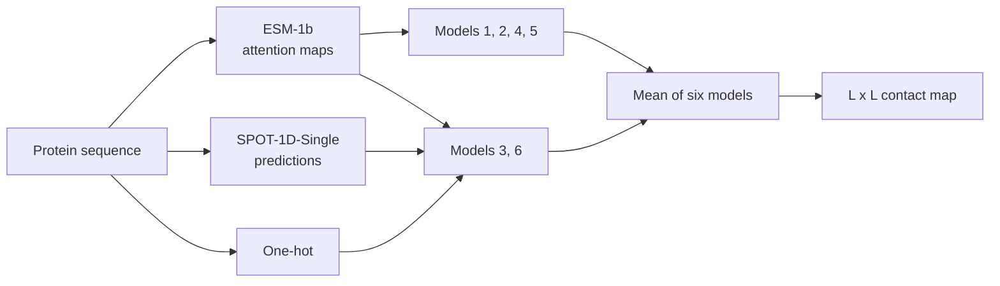

# SPOT-Contact-LM

**Predict a protein's residue–residue contact map from a single sequence, using ESM-1b attention maps instead of multiple sequence alignments.**

[](https://doi.org/10.1093/bioinformatics/btac053)
[](https://huggingface.co/Jas-preet/SPOT-Contact-LM)
[](https://huggingface.co/datasets/Jas-preet/SPOT-datasets)
[](https://github.com/jas-preet/SPOT-Contact-LM/actions/workflows/tests.yml)
[](LICENSE)

Accurate contact maps are essential for predicting protein structure and function. Most contact predictors rely on evolutionary information, which may not exist for proteins with few natural homologs and is slow to compute. SPOT-Contact-LM (also called SPOT-Contact-Single, the name of the script) uses the attention maps of the pre-trained [ESM-1b](https://github.com/facebookresearch/esm) language model, together with a large training set and an ensemble of residual networks.

## Contents

- [Highlights](#highlights)
- [Quick start](#quick-start)
- [Method](#method)
- [Results from the paper](#results-from-the-paper)
- [Installation](#installation)
- [Usage](#usage)
- [Output](#output)
- [Working with the output](#working-with-the-output)
- [Limitations](#limitations)
- [Datasets](#datasets)
- [Related tools](#related-tools)
- [Tests](#tests)
- [Citation](#citation)
- [License](#license)

## Highlights

- **No alignment needed.** Contacts come from the sequence alone.
- **Better than profile-based methods on proteins with no homologs.** On SPOT-2018 proteins with Neff = 1, the F1-score is 48.7% higher than trRosetta and 48.5% higher than SPOT-Contact.
- **Better than earlier single-sequence methods.** On CASP14 free-modelling targets, the F1-score is 15% higher than SSCpred, and long-range precision is 50–110% higher.
- **Fast.** In the paper, the 15 CASP14-FM proteins took 116 seconds on CPU, 22 times faster than trRosetta.

## Quick start

SPOT-Contact-LM reads the output of [SPOT-1D-Single](https://github.com/jas-preet/SPOT-1D-Single), which is included for the CASP14 examples.

```bash
git clone https://github.com/jas-preet/SPOT-Contact-LM.git
cd SPOT-Contact-LM
pip install -r requirements.txt

curl -LO https://huggingface.co/Jas-preet/SPOT-Contact-LM/resolve/main/contact_jits.tar.xz
echo "fb68555f977543f0f31e30d845f9c927cfb1216fd63dd263bc86a93feecf9e81  contact_jits.tar.xz" | shasum -a 256 -c
tar -xf contact_jits.tar.xz

python -W ignore spot_contact_single.py --file_list file_list/test_file_list.txt --save_path results/
```

On Linux, use `sha256sum -c` instead of `shasum -a 256 -c`. The first run downloads ESM-1b (about 7 GB).

## Method

Each protein is described by three kinds of features:

- **ESM-1b attention maps,** either the 20 heads of the last layer or the 20 heads of every layer. Both are symmetrized and given average product correction.
- **One-hot encoding** of the sequence.
- **[SPOT-1D-Single](https://github.com/jas-preet/SPOT-1D-Single) predictions:** 3- and 8-state secondary structure probabilities, ASA, HSE and the ψ, ϕ, θ and τ angles.

The one-hot and SPOT-1D-Single features are turned into pairwise (2D) features by outer concatenation. Six networks, each a 12-block ResNet with 64 channels and 3 × 3 kernels, are averaged to give the final map:

| Model | Features | Trained to predict |
| --- | --- | --- |
| 1 | Attention, last layer | Contacts |
| 2 | Attention, all layers | Contacts |
| 3 | Attention, all layers + one-hot + SPOT-1D-Single | Contacts |
| 4 | Attention, last layer | Distance bins |
| 5 | Attention, all layers | Distance bins |
| 6 | Attention, all layers + one-hot + SPOT-1D-Single | Distance bins |

The distance-bin models are turned into contact probabilities by adding up the probabilities of the bins up to 8 Å.



**Contacts** are residue pairs whose Cβ atoms are within 8 Å. The paper reports long-range (sequence separation ≥ 24), medium-range (12–23) and short-range (7–11) contacts.

**Training data:** the SPOT-1D-Single set from ProteinNet, with PDB chains deposited before 2016, resolution below 2.5 Å and clustered at 95% sequence identity. After removing chains longer than 500 residues, 34,691 proteins were used for training and 88 for validation.

## Results from the paper

All numbers are copied from [Singh et al., 2022](https://doi.org/10.1093/bioinformatics/btac053). Precision is in %, for the top L/10, L/5, L/2 and L predicted contacts, where L is the sequence length.

**CASP14 free-modelling targets, 15 proteins** (Table 5)

| Method | Long range L/10 | L/5 | L/2 | L | Medium range L/10 | L/5 | L/2 | L |
| --- | --- | --- | --- | --- | --- | --- | --- | --- |
| **SPOT-Contact-LM** | **18.92** | **19.38** | **15.40** | **11.56** | **29.73** | **24.72** | **17.96** | **13.93** |
| SSCpred | 9.91 | 9.13 | 7.66 | 7.69 | 26.13 | 24.50 | 17.17 | 12.61 |
| ESM-1b | 17.12 | 12.47 | 9.42 | 7.38 | 22.97 | 19.82 | 15.58 | 10.85 |
| *SPOT-Contact (profile-based)* | *25.23* | *21.16* | *19.28* | *16.21* | *41.44* | *36.08* | *26.41* | *17.09* |

Among methods that don't use alignments, SPOT-Contact-LM is the most precise. The profile-based SPOT-Contact is still more precise on these targets.

**Proteins with no homologs (Neff1-2018, 46 proteins)**

For long-range contacts, L/5 precision is about 24% for SPOT-Contact-LM, compared with about 16% for SPOT-Contact, trRosetta and ESM-1b. Profile-based methods overtake SPOT-Contact-LM as the number of homologs grows, so it is most useful for proteins with few homologs.

**Which features matter** (Table 2, single ResNet on SPOT-2018, 669 proteins, long-range precision)

| Features | L/10 | L/5 | L/2 | L |
| --- | --- | --- | --- | --- |
| One-hot | 7.02 | 6.15 | 5.04 | 4.40 |
| One-hot + SPOT-1D-Single | 10.00 | 8.12 | 7.06 | 5.40 |
| ESM-1b attention, last layer | 35.14 | 30.34 | 22.75 | 17.02 |
| ESM-1b attention, all layers | 36.03 | 30.92 | 23.75 | 18.13 |
| All features | 38.75 | 33.23 | 25.22 | 18.94 |
| **Ensemble of six models** (Table 4) | **39.60** | **34.35** | **25.94** | **19.62** |

## Installation

### Requirements

- Python 3 (tested with 3.12) and the packages in `requirements.txt`
- About 8 GB of disk space, because ESM-1b is downloaded the first time it runs
- Memory on CPU that grows with the square of the sequence length, as shown below
- Optional: an NVIDIA GPU with CUDA

| Sequence length | Estimated memory on CPU |
| --- | --- |
| 100 residues | 10 GB |
| 200 residues | 14 GB |
| 300 residues | 22 GB |
| 400 residues | 32 GB |
| 1,000 residues | 154 GB |

These figures come from a Mac using a PyTorch build without oneDNN, and other systems may use less. The largest measured run was 27.6 GB, for 404 residues. The program estimates this before it starts, and stops if the estimate is more than three quarters of your total RAM. This does not account for memory already in use, or for limits set by a container or job scheduler, so set `--max_memory_gb` to match in those cases. To go above the default limit, use `--max_memory_gb`, but only if you are sure the memory is available, because running out can make the computer unresponsive.

### Code

```bash
git clone https://github.com/jas-preet/SPOT-Contact-LM.git
cd SPOT-Contact-LM
pip install -r requirements.txt
```

### Checkpoints

Download the checkpoints (101 MB) from [Hugging Face](https://huggingface.co/Jas-preet/SPOT-Contact-LM) and check the download:

```bash
curl -LO https://huggingface.co/Jas-preet/SPOT-Contact-LM/resolve/main/contact_jits.tar.xz
echo "fb68555f977543f0f31e30d845f9c927cfb1216fd63dd263bc86a93feecf9e81  contact_jits.tar.xz" | shasum -a 256 -c
tar -xf contact_jits.tar.xz
```

If Hugging Face is unavailable, the same file is on the lab server (plain HTTP only, so keep the checksum check):

```bash
curl -LO http://183.36.5.251:8080/sparks_downloads/servers/downloads/Resource/Protein/2_Protein_local_structure_prediction/contact_jits.tar.xz
```

It is also listed on the [Zhou lab download page](https://zhouyq-lab.szbl.ac.cn/download/).

## Usage

1. Run [SPOT-1D-Single](https://github.com/jas-preet/SPOT-1D-Single) on your proteins, then copy its CSV files to `data_files/out_spot_1d_sgl/` or point `--spot_single_dir` at them. This output is already included for the CASP14 examples.
2. Make a text file listing one FASTA file per line.
3. Run:

```bash
python -W ignore spot_contact_single.py --file_list file_list/test_file_list.txt --save_path results/ --device cpu --esm_device cpu
```

On a GPU, use `--device cuda:0 --esm_device cuda:0`. On CPU, `file_list/file_list_casp14.txt` includes a 404-residue protein, so it needs `--max_memory_gb 33` on computers with less than 43 GB of RAM.

| Option | Description |
| --- | --- |
| `--file_list` | Required. Text file with one FASTA path per line. Relative paths are resolved from the current directory. |
| `--save_path` | Output directory, created if needed. Default: `results/` |
| `--device` | `cpu` (default) or `cuda:0` |
| `--esm_device` | Device for ESM-1b, such as `cpu` (default) or `cuda:0` |
| `--jits_dir` | Directory holding the checkpoints. Default: `contact_jits/` next to the script |
| `--spot_single_dir` | Directory holding SPOT-1D-Single output. Default: `data_files/out_spot_1d_sgl/` next to the script |
| `--max_memory_gb` | Memory limit for the CPU estimate. Default: three quarters of RAM |

Each FASTA file must contain one sequence. Lower-case letters are accepted, a trailing `*` is removed, and letters ESM-1b cannot encode, such as `J`, are treated as unknown. Proteins are identified by FASTA file name, so names in a list must be unique. The SPOT-1D-Single CSV must have been made from the same sequence, and the program stops with an error if it wasn't.

## Output

Each input produces `<save_path>/<fasta file name>.npy`, an L × L NumPy array of contact probabilities (`float32`), where L is the sequence length. Predictions for all 15 CASP14-FM targets are in `results/`.

The map is not exactly symmetric: entry (i, j) and entry (j, i) can differ. Average it with its transpose if you need a symmetric map, as in the example below.

## Working with the output

List the most likely long-range contacts:

```python
import numpy as np

contacts = np.load("results/T1046s1-D1.npy")   # L x L contact probabilities
contacts = (contacts + contacts.T) / 2         # the two halves can differ; average them
L = contacts.shape[0]

# Top L/5 long-range contacts (sequence separation >= 24)
i, j = np.triu_indices(L, k=24)
order = np.argsort(contacts[i, j])[::-1][: L // 5]
for a, b in zip(i[order][:5], j[order][:5]):
    print(f"residue {a + 1:>3} - residue {b + 1:>3}  p = {contacts[a, b]:.3f}")
```

```text
residue  33 - residue  60  p = 0.346
residue  18 - residue  60  p = 0.322
residue  18 - residue  56  p = 0.311
residue  14 - residue  56  p = 0.287
residue  18 - residue  63  p = 0.287
```

Plot the map:

```python
import matplotlib.pyplot as plt
import numpy as np

contacts = np.load("results/T1046s1-D1.npy")
plt.imshow((contacts + contacts.T) / 2, cmap="Greys", origin="lower")
plt.colorbar(label="contact probability")
plt.xlabel("residue")
plt.ylabel("residue")
plt.savefig("T1046s1-D1_contacts.png", dpi=150)
```

## Limitations

- ESM-1b accepts up to 1,022 residues, so longer sequences are rejected.
- Only single chains are supported, so multimers and sequences with separators such as `:` are rejected. To get contacts within each chain of a complex, run each chain from its own FASTA file.
- For proteins with many homologs, profile-based methods are more accurate.
- The GPU checkpoints only run on `cuda:0`, because of how they were exported with `torch.jit.trace`.
- The training code is not included.

## Datasets

The training set is the SPOT-1D-Single set from ProteinNet. Its sequences, per-residue labels and the SPOT-2018-HQ and CASP14-FM lists are on Hugging Face as [Jas-preet/SPOT-datasets](https://huggingface.co/datasets/Jas-preet/SPOT-datasets). Contact maps are not included; they can be computed from the PDB structures (Cβ–Cβ distance of at most 8 Å).

## Related tools

| Tool | Input | Predicts | Use it when |
| --- | --- | --- | --- |
| [SPOT-1D-Single](https://github.com/jas-preet/SPOT-1D-Single) | Sequence | 1D structural properties | You need fast, light predictions; its output is also the input here |
| [SPOT-1D-LM](https://github.com/jas-preet/SPOT-1D-LM) | Sequence plus ESM-1b and ProtT5 embeddings | 1D structural properties, more accurately | You want the best 1D accuracy without alignments |
| **SPOT-Contact-LM** (this repo) | Sequence, ESM-1b and SPOT-1D-Single output | Residue contact map | You need contacts for structure modelling |

## Tests

The tests use small stand-in models, so they don't need any downloads.

```bash
pip install pytest
pytest
```

## Citation

If you use SPOT-Contact-LM, please cite:

Singh J, Litfin T, Singh J, Paliwal K, Zhou Y. SPOT-Contact-LM: improving single-sequence-based prediction of protein contact map using a transformer language model. *Bioinformatics*. 2022;38(7):1888-1894. [doi:10.1093/bioinformatics/btac053](https://doi.org/10.1093/bioinformatics/btac053)

```bibtex
@article{singh2022spotcontactlm,
  title   = {{SPOT-Contact-LM}: improving single-sequence-based prediction of protein contact map using a transformer language model},
  author  = {Singh, Jaspreet and Litfin, Thomas and Singh, Jaswinder and Paliwal, Kuldip and Zhou, Yaoqi},
  journal = {Bioinformatics},
  volume  = {38},
  number  = {7},
  pages   = {1888--1894},
  year    = {2022},
  doi     = {10.1093/bioinformatics/btac053}
}
```

Please also cite [ESM-1b](https://github.com/facebookresearch/esm) and [SPOT-1D-Single](https://github.com/jas-preet/SPOT-1D-Single).

## License

[MIT](LICENSE)
